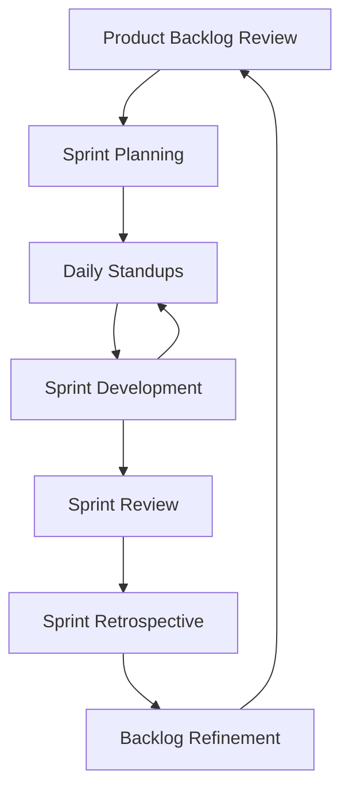
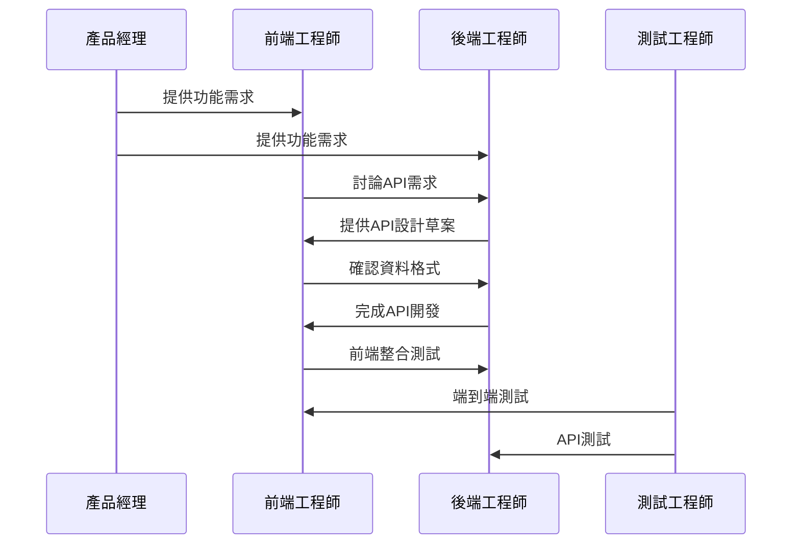

# 團隊整合方式 - PropAgent Pro

## 開發團隊架構

### 核心團隊組成

#### 技術團隊 (8-10人)
```
技術長 (CTO) - 1人
├── 前端開發團隊 - 3人
│   ├── 前端架構師/Team Lead - 1人
│   ├── React開發工程師 - 1人
│   └── UI/UX工程師 - 1人
├── 後端開發團隊 - 3人
│   ├── 後端架構師/Team Lead - 1人
│   ├── API開發工程師 - 1人
│   └── 資料庫工程師 - 1人
├── DevOps工程師 - 1人
├── QA測試工程師 - 1人
└── 行動端開發工程師 - 1人 (後期加入)
```

#### 產品團隊 (4-5人)
```
產品長 (CPO) - 1人
├── 產品經理 - 1人
├── UX/UI設計師 - 1人
├── 使用者研究員 - 1人
└── 數據分析師 - 1人
```

#### 業務與營運團隊 (6-8人)
```
營運長 (COO) - 1人
├── 業務開發經理 - 1人
├── 客戶成功經理 - 2人
├── 行銷經理 - 1人
├── 客服專員 - 2人
└── 業務助理 - 1人
```

### 角色職責定義

#### 前端團隊職責
```yaml
前端架構師/Team Lead:
  - 前端技術架構設計與規劃
  - 程式碼審查和技術標準制定
  - 團隊技術指導和培訓
  - 與後端團隊技術對接
  - 效能優化和最佳實踐推廣

React開發工程師:
  - 功能頁面開發和元件設計
  - API整合和狀態管理
  - 使用者互動功能實現
  - 單元測試和整合測試
  - Bug修復和功能迭代

UI/UX工程師:
  - 設計稿轉換為程式碼
  - CSS動畫和互動效果
  - 響應式設計實現
  - 瀏覽器相容性處理
  - 設計系統維護
```

#### 後端團隊職責
```yaml
後端架構師/Team Lead:
  - 系統架構設計和技術選型
  - 資料庫設計和優化
  - 程式碼審查和標準制定
  - 系統安全性和效能規劃
  - 技術團隊指導

API開發工程師:
  - RESTful API設計和開發
  - 業務邏輯實現
  - 第三方服務整合
  - API文件編寫
  - 錯誤處理和日誌記錄

資料庫工程師:
  - 資料庫架構設計
  - SQL查詢優化
  - 資料遷移和同步
  - 備份恢復策略
  - 效能監控和調優
```

## 開發流程規範

### Scrum敏捷開發流程

#### Sprint規劃 (每2週一個Sprint)


#### 會議時程表
```yaml
每日站立會議:
  時間: 每日上午9:30 (15分鐘)
  參與者: 全體開發團隊
  目的: 同步進度、識別阻礙、協調合作

Sprint規劃會議:
  時間: 每2週一次 (2小時)
  參與者: 產品經理、開發團隊、設計師
  目的: 確定Sprint目標和任務分配

Sprint回顧會議:
  時間: Sprint結束後 (1小時)
  參與者: 全體團隊
  目的: 展示成果、收集反饋

Sprint反思會議:
  時間: Sprint結束後 (1小時)
  參與者: 開發團隊
  目的: 流程改進、問題解決

產品待辦事項整理:
  時間: 每週三下午 (1小時)
  參與者: 產品經理、技術Lead
  目的: 需求細化、優先級調整
```

### Git工作流程

#### 分支策略 (Git Flow)
```
main (生產環境)
├── develop (開發主分支)
│   ├── feature/customer-management (功能開發)
│   ├── feature/property-search (功能開發)
│   └── feature/scheduling-system (功能開發)
├── release/v1.0.0 (發布準備)
└── hotfix/critical-bug-fix (緊急修復)
```

#### 程式碼提交規範
```bash
# 提交訊息格式
<type>(<scope>): <subject>

<body>

<footer>

# 類型說明
feat: 新功能
fix: 錯誤修復
docs: 文件更新
style: 程式碼格式化
refactor: 重構
test: 測試相關
chore: 建置工具或輔助工具的變動

# 範例提交訊息
feat(customer): 新增客戶意願評分算法

- 實現基於互動頻率的評分機制
- 整合歷史看房記錄分析
- 新增評分因子權重配置

Closes #123
```

#### 程式碼審查流程
```yaml
Pull Request規範:
  1. 功能分支開發完成後建立PR
  2. PR標題清楚描述變更內容
  3. 詳細描述變更原因和影響範圍
  4. 附上相關測試截圖或影片
  5. 指派至少2位審查者

審查檢查清單:
  程式碼品質:
    - 符合團隊編碼規範
    - 無明顯效能問題
    - 適當的錯誤處理
    - 程式碼可讀性良好
  
  功能完整性:
    - 功能按需求實現
    - 邊界條件處理
    - 使用者體驗考量
    - 瀏覽器相容性
  
  安全性:
    - 輸入驗證完整
    - 權限控制正確
    - 敏感資訊保護
    - SQL注入防護

審查時間要求:
  - 24小時內完成第一輪審查
  - 關鍵功能需技術Lead參與
  - 修改後24小時內re-review
```

## 技術協作規範

### 前後端API協作

#### API設計協作流程


#### API文件協作工具
```yaml
Swagger/OpenAPI規範:
  - 使用OpenAPI 3.0標準
  - 自動產生互動式文件
  - 包含請求/回應範例
  - 錯誤碼完整定義

Postman Collection:
  - 共享API測試集合
  - 環境變數配置
  - 自動化測試腳本
  - 團隊協作空間

API Mock服務:
  - 使用JSON Server或Mockoon
  - 前端獨立開發支援
  - 真實資料結構模擬
  - 回應延遲模擬
```

#### 資料格式協作規範
```typescript
// 統一回應格式
interface APIResponse<T> {
  success: boolean;
  data?: T;
  error?: {
    code: string;
    message: string;
    details?: any;
  };
  meta?: {
    page?: number;
    limit?: number;
    total?: number;
    has_next?: boolean;
  };
}

// 錯誤碼標準化
enum ErrorCode {
  VALIDATION_ERROR = 'VALIDATION_ERROR',
  UNAUTHORIZED = 'UNAUTHORIZED',
  FORBIDDEN = 'FORBIDDEN',
  NOT_FOUND = 'NOT_FOUND',
  INTERNAL_ERROR = 'INTERNAL_ERROR',
  RATE_LIMITED = 'RATE_LIMITED',
}

// 日期時間格式
// 統一使用ISO 8601格式: 2024-01-15T10:30:00.000Z
```

### 資料庫協作

#### 資料庫變更管理
```yaml
遷移文件命名規範:
  格式: YYYYMMDD_HHMMSS_描述.sql
  範例: 20240315_143000_add_customer_intent_score.sql

遷移腳本規範:
  - 包含UP和DOWN語句
  - 詳細註解說明變更原因
  - 考慮資料相容性
  - 包含回滾測試

審查流程:
  1. 資料庫工程師設計Schema
  2. 後端工程師確認業務邏輯
  3. 前端工程師確認資料需求
  4. 技術Lead最終審查
  5. 在staging環境測試
  6. 生產環境部署
```

#### 資料庫開發環境
```yaml
本地開發環境:
  - Docker Compose統一配置
  - 包含測試資料初始化
  - 自動執行遷移腳本
  - 支援重置到乾淨狀態

共享開發環境:
  - staging資料庫鏡像
  - 定期同步生產資料結構
  - 匿名化測試資料
  - 訪問權限管理
```

## 專案管理工具整合

### 任務管理系統

#### Jira配置
```yaml
專案結構:
  - 史詩(Epic): 大功能模組
  - 故事(Story): 使用者需求
  - 任務(Task): 開發子任務
  - 缺陷(Bug): 問題修復
  - 子任務(Sub-task): 細分工作

工作流程:
  待辦 → 進行中 → 程式碼審查 → 測試中 → 完成

自定義欄位:
  - 技術複雜度 (1-5分)
  - 業務優先級 (高/中/低)
  - 預估工時
  - 實際工時
  - 測試狀態
```

#### 任務分配原則
```yaml
Story Point估算:
  1分: 簡單修改 (半天內完成)
  2分: 小功能開發 (1天完成)
  3分: 中等功能 (2-3天完成)
  5分: 複雜功能 (1週完成)
  8分: 大型功能 (需要拆分)

任務分配策略:
  - 根據工程師專長分配
  - 考慮工作負載均衡
  - 新人搭配資深工程師
  - 跨領域任務協作開發
```

### 文件協作

#### Confluence知識庫
```yaml
文件架構:
  技術文件/
  ├── 架構設計文件
  ├── API文件
  ├── 資料庫設計
  ├── 部署指南
  └── 故障排除手冊
  
  產品文件/
  ├── 產品需求文件 (PRD)
  ├── 使用者故事
  ├── 原型設計
  └── 測試計畫
  
  營運文件/
  ├── 使用者手冊
  ├── 常見問題
  ├── 客服流程
  └── 業務培訓材料

文件維護規範:
  - 每個文件指定負責人
  - 重要變更需審查
  - 定期檢視更新狀態
  - 版本控制和歷史記錄
```

#### 設計協作 (Figma)
```yaml
設計文件組織:
  設計系統/
  ├── UI元件庫
  ├── 色彩和字體規範
  ├── 圖示庫
  └── 設計Token

頁面設計/
  ├── 線框圖 (Wireframes)
  ├── 高保真設計 (Hi-fi)
  ├── 互動原型 (Prototypes)
  └── 開發標註 (Handoff)

協作流程:
  1. 設計師建立設計稿
  2. 產品經理確認流程
  3. 工程師確認技術可行性
  4. 設計師調整並標註
  5. 開發開始實現
```

## 溝通協作規範

### 即時通訊 (Slack)

#### 頻道設置
```yaml
#general: 全公司公告和討論
#development: 技術團隊日常討論
#frontend: 前端團隊專用
#backend: 後端團隊專用
#product: 產品相關討論
#design: 設計團隊協作
#qa-testing: 測試相關討論
#devops: 部署和營運討論
#random: 非工作相關聊天
#customer-feedback: 客戶反饋收集

機器人整合:
  - Jira通知機器人
  - GitHub整合
  - 部署狀態通知
  - 監控告警通知
```

#### 溝通禮儀
```yaml
訊息規範:
  - 使用thread回覆保持討論結構
  - 重要訊息使用@channel通知
  - 緊急問題直接私訊或電話
  - 程式碼片段使用程式碼區塊
  - 長篇討論移至會議或文件

回應時間期待:
  - 工作時間: 2小時內回應
  - 緊急問題: 30分鐘內回應
  - 非工作時間: 次日回應
  - 請假期間: 自動回覆說明
```

### 會議管理

#### 定期會議安排
```yaml
每日站立會議:
  時間: 9:30-9:45 (15分鐘)
  形式: 線上/線下混合
  紀錄: 簡要記錄阻礙事項

週會:
  技術週會: 每週四 14:00-15:00
  產品週會: 每週二 10:00-11:00
  全員週會: 每週一 16:00-17:00

月會:
  技術分享會: 每月第一週五
  產品回顧: 每月最後一週
  團隊建設: 每月安排活動
```

#### 會議效率規範
```yaml
會議前:
  - 提前發送議程
  - 準備相關材料
  - 確認參與者時間
  - 設定明確目標

會議中:
  - 控制時間長度
  - 記錄決議事項
  - 明確後續行動
  - 避免離題討論

會議後:
  - 24小時內發送會議記錄
  - 追蹤行動項目進度
  - 更新相關文件
  - 安排後續會議
```

## 品質保證流程

### 程式碼品質

#### 自動化檢查
```yaml
程式碼格式化:
  前端: Prettier + ESLint
  後端: Prettier + ESLint
  提交前: Husky + lint-staged
  CI/CD: 自動格式檢查

程式碼分析:
  SonarQube: 程式碼品質分析
  CodeClimate: 維護性評分
  Security Scanner: 安全漏洞檢測
  Dependency Check: 套件安全檢查

測試覆蓋率:
  單元測試: >80%
  整合測試: >60%
  E2E測試: 核心流程100%
  每日自動執行測試套件
```

#### 人工審查流程
```yaml
程式碼審查清單:
  功能性:
    ☐ 功能按需求正確實現
    ☐ 邊界條件適當處理
    ☐ 錯誤處理完整
    ☐ 效能考量適當
  
  可維護性:
    ☐ 程式碼結構清晰
    ☐ 命名規範一致
    ☐ 適當的註解說明
    ☐ 可測試性良好
  
  安全性:
    ☐ 輸入驗證完整
    ☐ 權限控制正確
    ☐ 敏感資料保護
    ☐ 不包含硬編碼祕密

審查分配:
  - 新手工程師: 2位資深工程師審查
  - 資深工程師: 1位同級+1位Lead審查
  - 關鍵功能: 技術Lead必須參與
  - 安全相關: 安全專家參與審查
```

### 測試策略

#### 測試金字塔
```yaml
單元測試 (70%):
  - 函數/方法層級測試
  - 前端元件測試
  - 後端業務邏輯測試
  - 資料庫查詢測試
  
整合測試 (20%):
  - API整合測試
  - 資料庫整合測試
  - 第三方服務模擬測試
  - 跨模組整合測試

端到端測試 (10%):
  - 使用者旅程測試
  - 關鍵業務流程測試
  - 跨瀏覽器相容性測試
  - 效能測試
```

#### 測試環境管理
```yaml
開發環境:
  - 開發者本機環境
  - 快速反饋循環
  - 模擬資料和服務

整合環境:
  - 持續整合觸發
  - 自動化測試執行
  - 與真實服務整合

預發布環境:
  - 生產環境鏡像
  - 完整功能測試
  - 使用者驗收測試

生產環境:
  - 監控和告警
  - 熱修復部署
  - 回滾機制
```

## 部署與發布流程

### CI/CD管道

#### GitHub Actions工作流程
```yaml
# .github/workflows/ci.yml
name: CI/CD Pipeline

on:
  push:
    branches: [main, develop]
  pull_request:
    branches: [main, develop]

jobs:
  test:
    runs-on: ubuntu-latest
    steps:
      - uses: actions/checkout@v3
      - name: Setup Node.js
        uses: actions/setup-node@v3
        with:
          node-version: '18'
      - name: Install dependencies
        run: npm ci
      - name: Run linting
        run: npm run lint
      - name: Run tests
        run: npm run test:coverage
      - name: Upload coverage
        uses: codecov/codecov-action@v3

  build:
    needs: test
    runs-on: ubuntu-latest
    steps:
      - uses: actions/checkout@v3
      - name: Build Docker image
        run: docker build -t propagent/app:${{ github.sha }} .
      - name: Push to registry
        run: docker push propagent/app:${{ github.sha }}

  deploy-staging:
    needs: build
    if: github.ref == 'refs/heads/develop'
    runs-on: ubuntu-latest
    steps:
      - name: Deploy to staging
        run: ./scripts/deploy.sh staging ${{ github.sha }}

  deploy-production:
    needs: build
    if: github.ref == 'refs/heads/main'
    runs-on: ubuntu-latest
    environment: production
    steps:
      - name: Deploy to production
        run: ./scripts/deploy.sh production ${{ github.sha }}
```

#### 發布管理
```yaml
版本發布流程:
  1. 功能開發完成並測試通過
  2. 合併到develop分支
  3. 在staging環境驗證
  4. 建立release分支
  5. 進行最終測試和調整
  6. 合併到main分支
  7. 自動部署到生產環境
  8. 建立版本標籤

Hotfix流程:
  1. 從main分支建立hotfix分支
  2. 快速修復關鍵問題
  3. 在staging環境測試
  4. 合併回main和develop
  5. 緊急部署到生產環境

發布排程:
  主要版本: 每月第一週發布
  次要版本: 每兩週發布
  修補版本: 按需發布
  緊急修復: 24小時內發布
```

### 監控與告警

#### 系統監控
```yaml
應用監控:
  - APM工具: New Relic / DataDog
  - 錯誤追蹤: Sentry
  - 日誌聚合: ELK Stack
  - 效能監控: Prometheus + Grafana

基礎設施監控:
  - 伺服器監控: CloudWatch / Nagios
  - 網路監控: Pingdom / UptimeRobot
  - 資料庫監控: pg_stat_monitor
  - 快取監控: Redis監控儀表板

業務監控:
  - 使用者行為: Google Analytics
  - 產品指標: Mixpanel / Amplitude
  - 轉換率: 自定義儀表板
  - 客戶滿意度: NPS追蹤

告警設定:
  嚴重告警:
    - 系統當機 (立即通知)
    - 資料庫連線失敗 (5分鐘內通知)
    - 重要API回應時間>5秒 (10分鐘內通知)
  
  警告告警:
    - CPU使用率>80% (30分鐘內通知)
    - 記憶體使用率>85% (30分鐘內通知)
    - 錯誤率>5% (15分鐘內通知)
  
  通知方式:
    - Slack頻道通知
    - 電子郵件通知
    - 簡訊通知 (嚴重告警)
    - PagerDuty整合 (值班輪替)
```

## 知識管理與培訓

### 技術文件管理

#### 文件分類體系
```yaml
架構文件:
  - 系統整體架構圖
  - 資料流程圖
  - 技術決策記錄 (ADR)
  - 系統邊界和整合點

開發指南:
  - 編碼規範和最佳實踐
  - 開發環境設置指南
  - 常用工具和指令
  - 故障排除手冊

API文件:
  - RESTful API規範
  - GraphQL Schema
  - WebSocket事件定義
  - 第三方API整合文件

部署文件:
  - 環境配置指南
  - 部署腳本說明
  - 監控設置文件
  - 災難恢復計畫
```

#### 知識分享機制
```yaml
技術分享會:
  頻率: 每月第一個週五
  時間: 2小時
  形式: 15分鐘演講 + 5分鐘Q&A
  主題: 新技術、最佳實踐、專案經驗

Lunch & Learn:
  頻率: 每週三中午
  時間: 1小時
  形式: 非正式討論
  主題: 工具分享、小技巧、業界動態

程式碼審查分享:
  頻率: 每週
  形式: 在Slack分享優秀程式碼片段
  目的: 推廣最佳實踐、學習新技巧

外部會議參與:
  鼓勵參加技術會議和研討會
  會後分享學習心得
  公司支援相關費用
```

### 新人培訓計畫

#### 第一週：環境設置和基礎了解
```yaml
Day 1-2: 公司和產品介紹
  - 公司文化和價值觀
  - 產品功能和使用者群體
  - 團隊介紹和角色說明
  - 開發環境設置

Day 3-4: 技術架構學習
  - 系統架構概覽
  - 程式碼庫結構說明
  - 開發工具和流程介紹
  - 第一個簡單任務

Day 5: 流程熟悉
  - Git工作流程實踐
  - 程式碼審查參與
  - 部署流程觀摩
  - 週總結和反饋
```

#### 第二週：實際開發參與
```yaml
任務分配:
  - 選擇適合新人的故事點1-2分任務
  - 安排Buddy進行指導
  - 鼓勵提問和討論
  - 參與團隊會議

技能評估:
  - 程式碼品質評估
  - 溝通協作能力
  - 學習態度和速度
  - 團隊適應性
```

#### 第一個月：深度學習和貢獻
```yaml
進階任務:
  - 參與複雜功能開發
  - 獨立完成小功能模組
  - 參與技術討論和決策
  - 開始審查其他人的程式碼

績效評估:
  - 技術能力評估
  - 業務理解程度
  - 團隊協作表現
  - 後續發展計畫
```

## 團隊協作工具清單

### 必需工具
```yaml
通訊協作:
  - Slack: 即時通訊
  - Zoom: 視訊會議
  - Google Meet: 快速會議

專案管理:
  - Jira: 任務管理
  - Confluence: 文件協作
  - Notion: 知識庫 (備選)

開發工具:
  - GitHub: 程式碼管理
  - VS Code: 統一IDE
  - Postman: API測試
  - Docker: 容器化開發

設計協作:
  - Figma: UI設計
  - Miro: 流程圖和腦力激盪
  - Whimsical: 系統架構圖

監控分析:
  - Google Analytics: 使用者行為
  - Sentry: 錯誤追蹤
  - Grafana: 系統監控
```

### 推薦工具
```yaml
效率提升:
  - 1Password: 密碼管理
  - Loom: 螢幕錄製
  - Calendly: 會議排程
  - Grammarly: 英文寫作輔助

學習資源:
  - Pluralsight: 技術學習平台
  - O'Reilly: 技術書籍資料庫
  - Medium: 技術文章閱讀
  - Stack Overflow: 技術問答

時間管理:
  - Toggl: 時間追蹤
  - RescueTime: 工作效率分析
  - Focus: 番茄鐘工作法
```

這個團隊整合方式文件涵蓋了PropAgent Pro專案的完整團隊協作框架，從組織架構、開發流程、溝通協作到品質保證，確保團隊能夠高效協作，交付高品質的產品。